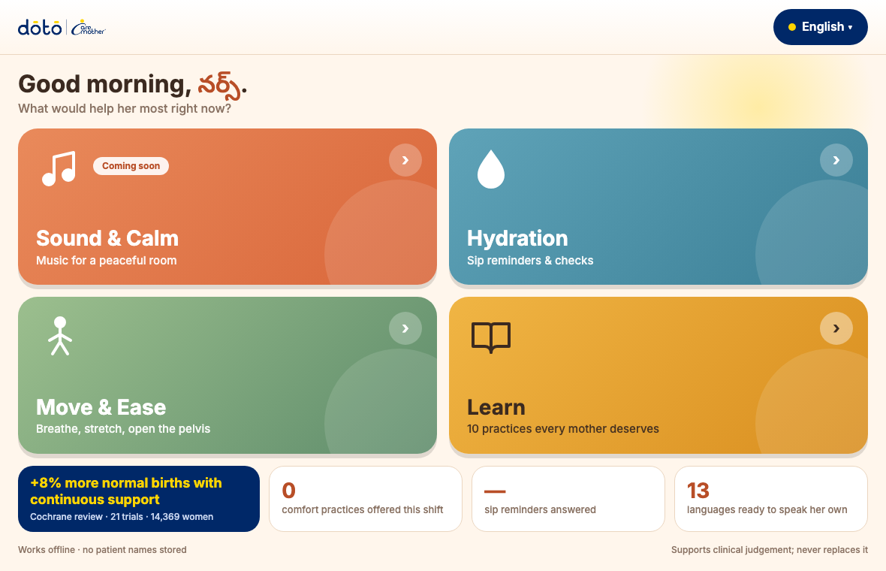
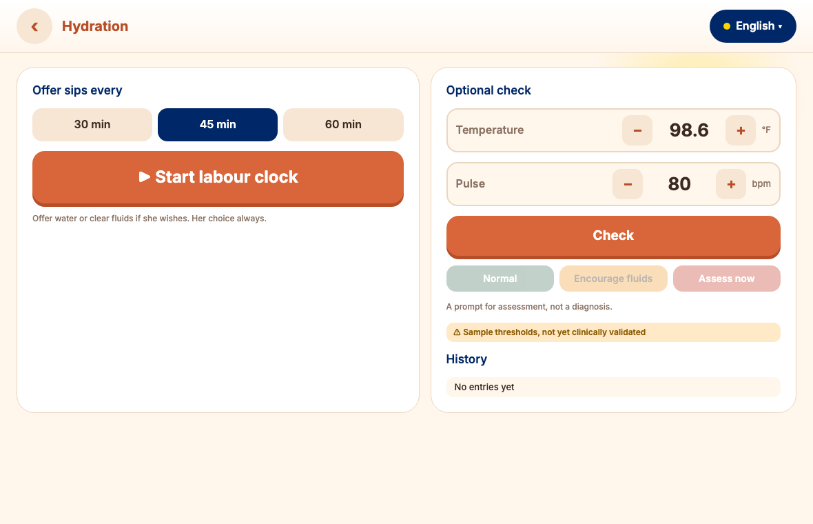
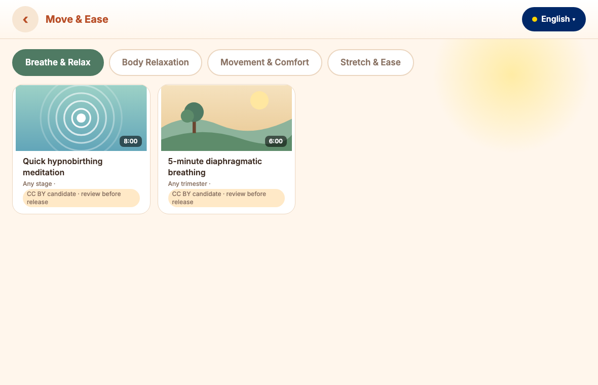
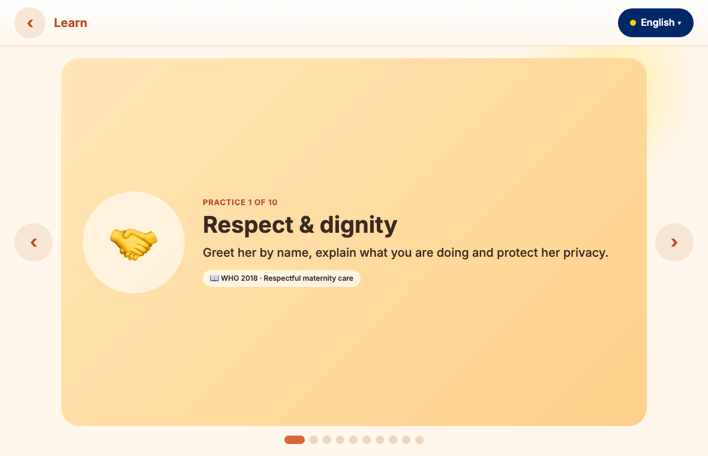

# Positive Birthing Companion

[](./LICENSE.md)
[](#licensing)
[](#status--roadmap)

**An open-source, offline-first companion for the labour room.** It puts WHO's positive-childbirth
practices in the hands of nurses and midwives at the bedside: sip reminders, comfort and movement
guidance, short evidence cards, in 13 Indian languages. No accounts, no patient data, no AI.

**[Project Charter](./PROJECT_CHARTER.md)** · [Architecture](./ARCHITECTURE.md) · [Developer Docs](https://doto-health.github.io/positive-birthing-experience/)

> **Status: Phase 1 prototype (v0.1).** The app runs and is open for review, but its **clinical content
> is draft and has not been clinically reviewed**: the hydration thresholds are samples, the
> non-English text is machine-translated, and the learning cards await sign-off. **Do not use it with
> patients yet.** See [QA_PROCESS.md](QA_PROCESS.md).

<p align="center">
  
  
</p>
<p align="center">
  
  
</p>

## Why this exists

- About 140 million women give birth every year. Beyond survival, **how a woman is treated and what she
  experiences during labour matters**: to her, her baby and her health afterwards.
- WHO's 2018 guideline sets out 56 recommendations for a positive childbirth experience: a companion of
  choice, respectful care, freedom to eat, drink and move, comfort measures, and avoiding unnecessary
  interventions. But a long guideline is hard to use in the middle of a shift.
- This project turns a small set of those practices into **simple actions a nurse can take in one or
  two taps**, and makes it free for any facility to use, translate and adapt.

Read the full background, evidence and references in the **[Concept Note](docs/CONCEPT_NOTE.md)**.

## What it does

| Module           | What it gives the nurse                                                                                                                                                                                                                                                                                         |
| ---------------- | --------------------------------------------------------------------------------------------------------------------------------------------------------------------------------------------------------------------------------------------------------------------------------------------------------------- |
| **Hydration**    | One tap starts a labour clock. At the facility's interval a soft chime and banner remind the nurse to offer sips, on any screen. _Offered_ or _She declined_: her choice, always. An optional temperature and pulse check returns Normal / Attention / Alert as a **prompt for assessment, never a diagnosis**. |
| **Move & Ease**  | Breathing, relaxation, positions and stretches, as video cards that link to Creative Commons videos. Files are not bundled; cards show "coming soon" until a licensed file exists.                                                                                                                              |
| **Learn**        | Ten swipeable practice cards (respect, companion, sips, movement, skin-to-skin, when to call for help), each with its source.                                                                                                                                                                                   |
| **Sound & Calm** | Comfort music in three categories. **Coming soon**: no track is currently licensed for open redistribution.                                                                                                                                                                                                     |

**Also:** a greeting that follows the clock, 13 languages with right-to-left support (English, Hindi,
Kannada, Tamil, Malayalam, Telugu, Marathi, Gujarati, Assamese, Odia, Bengali, Punjabi, Urdu), anonymous
per-shift counters, installable as an app, and works with no network after the first load.

## Try it

You need only **Node 20 or newer** to run the development server. The app itself is static files.

```bash
node tools/serve.mjs 8080      # then open http://localhost:8080
```

- Add `?demo=1` to the address for a 1-minute sip-reminder interval, handy for demos.
- Use the bundled server rather than `python -m http.server`: media seeking needs HTTP Range support.
- For a kiosk or tablet, serve the `app/` folder from any static host and install it as a PWA.
- Run the checks and tests with `npm run ci` (or `node tools/check-content.mjs` and `node --test`).

## Repository map

```
app/            the web app (index.html, js/, css/, data/, locales/, assets/)
docs/           concept note and screenshots
legal/          third-party credits and licence evidence
LICENSES/       full licence texts
research/       evidence base, licence research, content candidates
tests/          unit tests, including the hydration test-case table
tools/          dev server and CI scripts
mockups/        approved UI mockups
.github/        CI workflow and pull-request template
```

## Edit the content

Content is separate from code, so clinicians, translators and designers can contribute without
touching JavaScript.

| To change                                                | Edit                                                                                 | Clinical review?          |
| -------------------------------------------------------- | ------------------------------------------------------------------------------------ | ------------------------- |
| Sip reminder intervals, temperature and pulse thresholds | `app/data/hydration-rules.json`                                                      | **Yes**                   |
| Learning cards                                           | `app/data/learn.json` and the card strings in `app/locales/*.json`                   | **Yes**                   |
| Health claims on the home screen                         | `app/data/facts.json`                                                                | **Yes**                   |
| Videos offered                                           | `app/data/videos.json`                                                               | **Yes**                   |
| Translations                                             | `app/locales/<code>.json`                                                            | **Yes** for clinical text |
| Music                                                    | `app/data/tracks.json` (licensed tracks only; record each in `legal/ATTRIBUTION.md`) | Licence check             |
| Interface layout and styling                             | `app/css/`, `app/js/`                                                                | Technical review only     |

## Quality and clinical review

Every pull request into `main` gets a **technical (code) review**. Any pull request that touches
clinical content also gets a **clinical review** by a qualified reviewer, and CI enforces that a
clinical sign-off was recorded. One cannot override the other. Details, checklists and what counts as
clinical content are in **[QA_PROCESS.md](QA_PROCESS.md)**; how the app is built is in
**[ARCHITECTURE.md](ARCHITECTURE.md)**.

## Digital Public Good

This project is built to be a **Digital Public Good**: open licences, no vendor lock-in, no personal
data, adaptable to new languages and settings. It is **not yet registered** with the Digital Public
Goods Alliance. [ARCHITECTURE.md](ARCHITECTURE.md#8-digital-public-good-alignment) maps the project to the
nine indicators of the [DPG Standard](https://digitalpublicgoods.net/standard/) with an honest status for each.

## Licences

| What                                                                    | Licence                                                                                               |
| ----------------------------------------------------------------------- | ----------------------------------------------------------------------------------------------------- |
| Source code (`app/js`, `app/css`, `tools`, `tests`)                     | Apache-2.0 ([LICENSE](LICENSE.md))                                                                    |
| Our own content (translations, learning cards, artwork, research notes) | CC BY-SA 4.0 ([LICENSES/CC-BY-SA-4.0.txt](LICENSES/CC-BY-SA-4.0.txt))                                 |
| Linked YouTube videos                                                   | Their creators' CC BY, credited in [legal/ATTRIBUTION.md](legal/ATTRIBUTION.md); not relicensed by us |
| Logo and names                                                          | Trademarks of Doto Health, not open-licensed ([TRADEMARKS.md](TRADEMARKS.md))                         |
| Music                                                                   | None included yet                                                                                     |

**No audio or video files are stored in this repository.** Earlier test music was removed because none of
it was licensed for public redistribution ([research/audio-licences.md](research/audio-licences.md)).

## Privacy

No accounts, no patient names, phone numbers or IDs, and no analytics. The chosen language, the labour
clock and anonymous shift counters are stored **only on the device**. The only external request is the
font stylesheet, loaded from Google Fonts on first visit. Longitudinal patient records are out of scope
for this phase and would need their own privacy and consent design under India's DPDP Act, 2023.

## Roadmap and open items

**Needed before any clinical use**

- Form the Clinical/Obstetric Advisory Board; validate the hydration thresholds; approve the learning cards and video picks
- Native-speaker and clinical review of all 13 languages

**Next**

- Licensed music (CC0 or CC BY) for Sound & Calm
- An in-app credits screen; bundle the font files for a fully offline first load
- Accessibility audit and usability testing with nurses and midwives
- Export of anonymous counters (a Digital Public Good indicator) and a privacy notice
- Confirm the code licence (the Project Charter says Apache-2.0, the PRD said MIT)

**Later**

- Labour-room display casting; EMR and bedside-monitor integration; clinician dashboards; more languages

## Contributing

Contributions are welcome: code, translations, clinical review, accessibility or evidence.

1. Open an issue or a draft pull request describing the change.
2. For clinical content, **cite your source** (WHO recommendation, guideline or review) and never mark
   content as "validated" yourself.
3. Fill in the pull-request template. CI must pass; clinical changes also need a recorded clinical review.
4. Third-party content must have a verified open licence recorded in `legal/ATTRIBUTION.md`.

Read [QA_PROCESS.md](QA_PROCESS.md) first. If you think content is clinically wrong or unsafe, open an
issue labelled `clinical-safety`; these are triaged before anything else.

## Acknowledgements

Developed by Doto Health as part of the UNICEF FemTech Ventures positive-birthing-experience initiative.
Evidence draws on WHO guidelines and Cochrane reviews listed in the [Concept Note](docs/CONCEPT_NOTE.md).
Mention of these organisations does not imply their endorsement of this project.

## Disclaimer

This software supports, and does not replace, the clinical judgement of qualified health workers. It does
not diagnose or treat any condition. Clinical content is a draft until reviewed under
[QA_PROCESS.md](QA_PROCESS.md).
